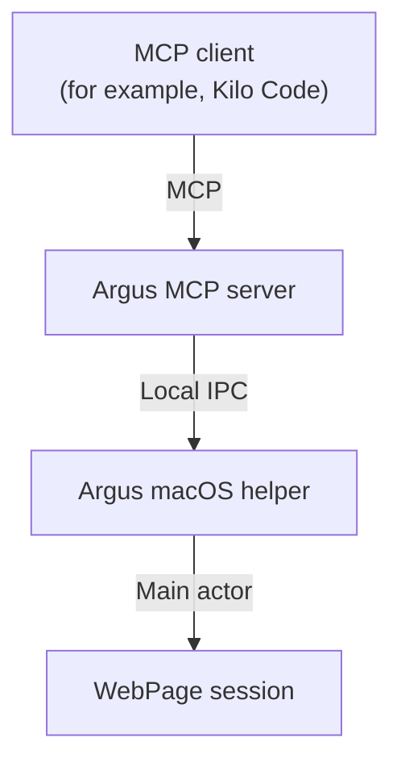

# AGENTS.md

## Project

**Argus** is a local MCP server and macOS helper that let MCP-compatible agents
navigate web pages and evaluate JavaScript through Apple’s SwiftUI WebKit
`WebPage` API.

The project has two components:

1. **MCP Server** — exposes browser capabilities as MCP tools and communicates
   with the macOS Helper.
2. **macOS Helper** — owns the `WebPage` session, performs WebKit operations
   on the main actor, and communicates with the MCP Server over local IPC.

The MCP client (for example, Kilo Code in VS Code) is external to this project.
The `WebPage` session is an internal part of the macOS Helper, not a separate
service unless a deliberate architectural change is approved.

## Core requirements

- Use Swift for the project unless the user explicitly requests another
  implementation language.
- Verify that the installed macOS SDK and Swift toolchain support the required
  `WebPage` API before relying on it. Do not substitute `WKWebView` without
  documenting the change and getting approval.
- Keep a single `WebPage` instance alive for each browser session.
- Create, retain, use, and release `WebPage` on the main actor.
- Ensure the helper has a valid macOS application lifecycle and run loop while
  WebKit work is in progress.
- Keep MCP transport separate from WebKit and UI lifecycle code.
- Do not implement an MCP client; clients such as Kilo Code are outside the
  project.
- Do not claim a feature is implemented or validated unless it has been built
  and tested.

## Architecture

Use this logical flow:



The MCP Server validates tool arguments, forwards allowed requests to the
Helper, and converts Helper replies into MCP results.

The macOS Helper owns the browser session and dispatches WebKit work to the
main actor. It returns structured results and errors over IPC.

Use a local IPC mechanism, preferably a Unix domain socket, unless the existing
codebase establishes a suitable alternative. Define and document the IPC
message format before implementing both sides.

## Suggested project organization

Adapt names to the repository if it already has a consistent structure.

```text
Sources/
  ArgusMCPServer/
    main.swift
    MCP/
    IPC/
    Tools/
  ArgusMacOSHelper/
    App/
    Browser/
    IPC/
Tests/
  ArgusMCPServerTests/
  ArgusMacOSHelperTests/
```

Keep responsibilities clear:
* MCP/: MCP transport and protocol handling.
* Tools/: MCP tool schemas, validation, and dispatch.
* IPC/: request/reply types and local transport.
* Browser/: WebPage ownership and browser operations.
* App/: helper startup, lifecycle, and main-actor composition.
* Avoid placing all functionality in main.swift or mixing MCP protocol code
with WebKit calls.

## Browser session and concurrency

* Put the browser-session owner on the main actor, for example with an @MainActor type.
* Keep session ownership explicit; avoid creating a new WebPage per request.
* Serialize operations that target the same page unless concurrent behavior is intentionally designed and tested.
* Handle navigation completion, failure, timeout, cancellation, and shutdown.
* Do not block the main thread while waiting for navigation or IPC.
* Convert WebKit values into documented JSON-compatible result types.
* Bound the size of scripts, messages, and returned data.

## Initial MCP tools

Implement only the smallest useful tool set first:
* navigate: load a permitted URL and return navigation status, final URL, and title.
* evaluate_js: evaluate JavaScript in the current page and return a JSON-compatible result.
* get_page_info: return documented metadata about the current page.
* close_page: end the session and release resources.

For every tool, document its input schema, output schema, timeout, and error
behavior. Do not add tools that can run shell commands or access arbitrary
local files.

## Security requirements

Treat URLs, scripts, web content, and IPC messages as untrusted input.

* Validate URL syntax, scheme, and host before navigation.
* Deny unsupported schemes, including file:, by default.
* Provide a clear host-allowlist policy or an equivalent explicit restriction.
* Treat evaluate_js as code execution in the page context; validate inputs and enforce size and time limits.
* Do not expose shell execution, arbitrary filesystem access, or unrestricted local-network access through browser tools.
* Validate IPC message structure and reject malformed or oversized messages.
* Do not log page content, scripts, cookies, credentials, or other sensitive values by default.
* Return errors that are useful but do not disclose secrets or unnecessary local system details.

Document any known security limitations.

## VS Code and agent workflow

* Make the project buildable and testable from the terminal; do not require developers to use the Xcode GUI for routine work.
* Provide tested build, run, and test commands in the project README.
* Use the repository’s existing Swift Package Manager or Xcode project setup. Do not introduce a second build system without a clear need.
* Inspect the existing repository before changing its structure or replacing files.
* Make small, focused changes and preserve established naming and formatting.
* Run relevant tests and builds after code changes. Report failures accurately; do not claim success when a command was not run or failed.
* Do not add dependencies without checking maintenance, licensing, and platform compatibility.
* Never commit signing credentials, secrets, user data, or generated build artifacts.

## Validation checklist

Before calling a change complete, perform the checks that apply:

### Build and platform

* Confirm the target macOS version, Swift version, and SDK requirements.
* Build both the MCP Server and macOS Helper.
* Confirm the SDK exposes the intended WebPage API.
* Verify helper startup and clean shutdown.

### Main actor and lifecycle

* Verify WebPage creation, retention, use, and release occur on the main actor.
* Verify the helper remains alive and responsive across multiple requests.
* Test repeated navigation and JavaScript evaluation in one session.
* Test navigation failures, timeouts, cancellation, and helper termination.
* Verify requests targeting one session are serialized or follow documented concurrency rules.

### MCP and IPC

* Test tool discovery and invocation with an MCP-compatible client.
* Test valid, missing, malformed, and unexpected tool arguments.
* Verify requests receive matching replies or clear timeout/error responses.
* Test malformed, oversized, and interrupted IPC messages.
* Ensure diagnostics do not corrupt MCP transport output.

### Browser and security

* Test navigation to a controlled page and a permitted HTTPS page.
* Test page title, final URL, JavaScript results, and error handling.
* Verify disallowed schemes and hosts are rejected.
* Test oversized scripts and results, redirects, and navigation timeouts.
* Confirm logs do not contain sensitive browser data.

### Documentation

* Document prerequisites, build/run/test commands, and MCP client configuration.
* Document tool schemas, IPC behavior, security policy, and limitations.
* Mark incomplete or experimental functionality clearly.

### Definition of done

A feature is done only when:

1. Its behavior and error cases are documented.
1. Relevant tests have been added or updated.
1. The affected targets build successfully.
1. Applicable validation checks have been run.
1. Security and lifecycle implications have been considered.
1. The final report states what changed and which checks were actually run.