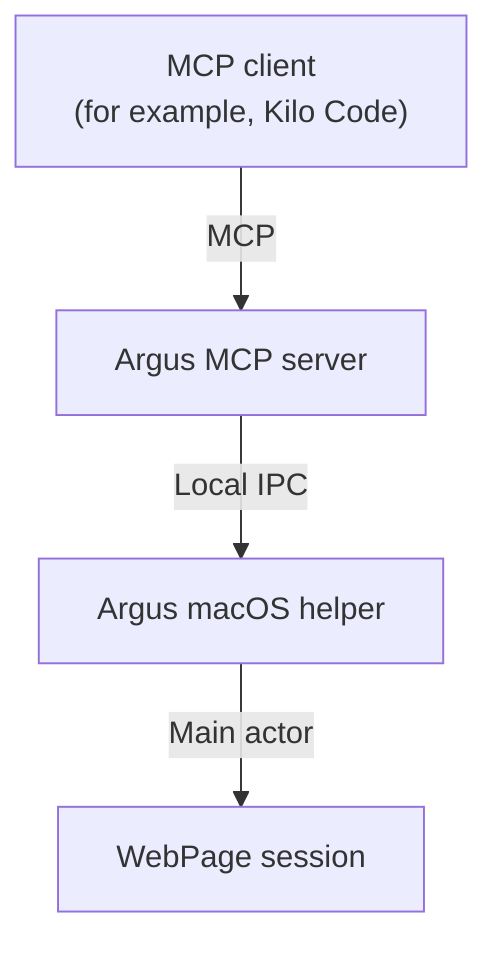

# Argus

A local MCP server for Apple’s SwiftUI WebKit `WebPage` API.

Argus lets MCP-compatible AI coding agents—such as Kilo Code in VS Code—navigate web pages and run JavaScript through a headless macOS browser session. It is designed to keep the browser session in a native macOS process while exposing a small, controlled set of browser tools over the Model Context Protocol (MCP).

> **Project status:** Proposed project specification. Features and validation criteria below describe the intended behavior; they should not be considered implemented until verified.

## Motivation

AI coding agents often need to inspect web pages, retrieve rendered content, or run JavaScript as part of a development workflow. A browser automation tool can provide those capabilities without requiring the agent to control a visible browser window.

Argus aims to provide that capability using Apple’s `WebPage` API, while keeping the browser lifecycle and WebKit work inside a native macOS process. The MCP interface allows compatible agents to request browser actions through a consistent tool protocol.

The name **Argus** refers to Argus Panoptes, the many-eyed figure of Greek mythology. It suggests a browser that can observe pages without displaying a browser window.

## Goals

- Provide browser navigation and JavaScript evaluation through MCP tools.
- Keep a `WebPage` instance alive for the lifetime of a browser session.
- Run WebKit operations on the main actor in a macOS process with the required application run loop.
- Support use from Kilo Code in VS Code and other compatible MCP clients.
- Keep the interface small, understandable, and safe by default.
- Return structured results and actionable errors.

## Non-goals

- Replacing a general-purpose browser for interactive human use.
- Providing unrestricted access to the host machine, shell, or filesystem.
- Bypassing website authentication, access controls, or anti-abuse protections.
- Guaranteeing that every website works with headless browsing.
- Executing arbitrary browser actions without policy checks or limits.

## Architecture

The intended architecture separates MCP communication from WebKit ownership:

The macOS helper owns and retains the WebPage instance. It dispatches navigation and JavaScript requests to the main actor. The MCP server validates incoming tool arguments, forwards allowed requests to the helper, and converts the helper’s replies into MCP results.

A local Unix domain socket with a small request/reply protocol is one possible IPC design. The chosen protocol should use request IDs, structured JSON messages, explicit errors, and bounded message sizes.

## Planned features

### Browser tools

* navigate — Load an allowed URL and return the final URL, page title, and navigation status.
* evaluate_js — Evaluate JavaScript in the current page and return a JSON-compatible result.
* get_page_info — Return basic information about the current page.
* close_page — End the browser session and release its resources.

The exact tool names and schemas may change as the implementation develops. Tools should be narrowly scoped and have documented input, output, timeout, and error behavior.

### Session behavior

* Keep one WebPage instance for a session rather than creating one for every request.
* Serialize operations that modify or inspect the same page unless concurrency behavior is deliberately designed and tested.
* Support clean startup, shutdown, and recovery from helper-process failure.
* Report navigation failures and timeouts instead of returning misleading success results.

### Security and safety criteria

Argus should treat pages, scripts, and page-derived data as untrusted.

* URL policy: Validate schemes and hosts before navigation. Deny unsupported schemes such as file: by default. Provide an explicit allowlist or configurable policy.
* JavaScript policy: Document that evaluate_js executes code in the page context. Apply input-size and execution-time limits. Consider disabling this tool or requiring explicit configuration for untrusted agents.
* No host powers by default: Do not expose shell execution, arbitrary filesystem access, or unrestricted local-network access through browser tools.
* Bounded output: Limit response size and avoid returning entire pages unless the caller explicitly requests a bounded extraction.
* Sensitive data: Do not log page contents, scripts, credentials, or cookies by default. Redact sensitive values in diagnostic output.
* IPC protection: Restrict the helper endpoint to the local user, validate every message, and reject malformed or oversized requests.
* Clear errors: Return structured errors without leaking secrets, local paths, or unnecessary implementation details.

### Validation plan

A release should not be considered validated until it passes the applicable checks below.

### Build and packaging

* Build successfully with a documented macOS version, Swift toolchain, and SDK.
* Confirm that the build uses the SDK version required for the WebPage API.
* Package and launch the helper as a macOS process with a valid application run loop.
* Verify that the MCP server can start the helper or connect to an already running helper.
* Verify clean shutdown and that no orphaned helper processes remain.

### Main-actor and lifecycle checks

* Confirm that creation, retention, navigation, JavaScript evaluation, and teardown of WebPage occur on the main actor.
* Confirm the helper stays alive and responsive across multiple MCP requests.
* Exercise repeated navigation and evaluation in the same session.
* Test behavior during slow loads, failed loads, redirects, and helper restarts.
* Verify that concurrent requests are serialized or handled according to documented session semantics.

### MCP protocol checks

* Validate tool discovery and invocation with an MCP-compatible client.
* Test valid, missing, malformed, and unexpected tool arguments.
* Verify that every request receives a matching response or a clear timeout/error.
* Confirm MCP transport output is not polluted by logs or diagnostics.
* Test client disconnects and interrupted requests.

### Browser behavior checks

* Navigate to a controlled local test page and a permitted HTTPS test site.
* Verify reported URL and title after successful navigation.
* Evaluate simple JavaScript expressions and check JSON-compatible results.
* Test invalid JavaScript, non-serializable results, navigation timeouts, and oversized output.
* Verify disallowed schemes and hosts are rejected before navigation.

### Security checks

* Test URL-policy bypass attempts, including alternate schemes, malformed URLs, and redirects to disallowed hosts.
* Test oversized messages, scripts, and results.
* Confirm the helper does not expose unintended local files or services.
* Review logs and errors for accidental disclosure of page data or sensitive values.
* Document any security limitations that cannot be mitigated.

### Documentation checks

* Include installation and build instructions that have been tested on a clean machine.
* Include a working MCP client configuration example.
* Document supported macOS and SDK requirements.
* Document tool schemas, policy configuration, limitations, and troubleshooting steps.
* Mark incomplete or experimental features clearly.

### Development principles

* Keep WebKit-specific code isolated in the macOS helper.
* Keep MCP transport and request validation separate from browser implementation.
* Prefer explicit policies and bounded behavior over implicit access.
* Add tests for error paths and security boundaries, not only successful browsing.
* Do not describe a feature as supported until it has passed the relevant validation checks.

