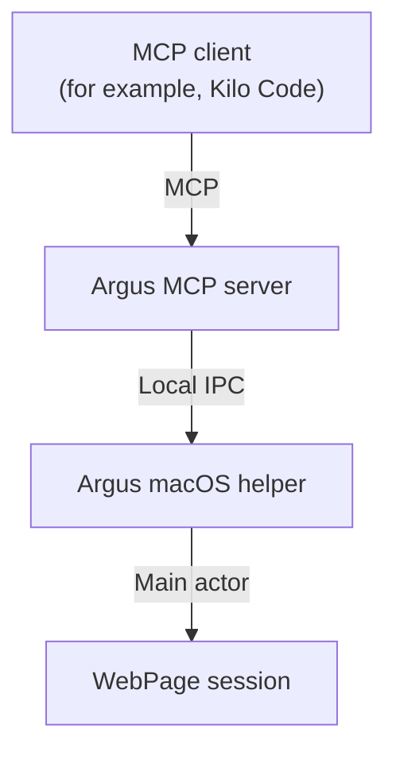

# Argus

A local MCP server for Apple's SwiftUI WebKit `WebPage` API.

Argus lets MCP-compatible AI coding agents—such as Kilo Code in VS Code—navigate web pages and run JavaScript through a headless macOS browser session. It is designed to keep the browser session in a native macOS process while exposing a small, controlled set of browser tools over the Model Context Protocol (MCP).

> **Project status:** Proposed project specification. Features and validation criteria below describe the intended behavior; they should not be considered implemented until verified.

## Verified Prerequisites

| Requirement | Version | Status |
|-------------|---------|--------|
| macOS | 15.0+ (Sequoia) / 26.0+ SDK | ✅ Verified |
| Swift | 6.0+ | ✅ Verified (6.4.2) |
| Xcode | 16.0+ | ✅ Verified |
| WebPage API | Available in macOS 26.0+ SDK | ✅ Verified |

> **Note:** The `WebPage` API is only available in macOS 26.0+ (corresponding to macOS 15.5+ / Sequoia). The API is limited: it supports navigation (`load`), `reload`, `stopLoading`, and read-only properties (`url`, `title`, `isLoading`). It does **not** support JavaScript evaluation, navigation history, or delegate callbacks. See [Known Limitations](#known-limitations).

## Architecture

The intended architecture separates MCP communication from WebKit ownership:



The macOS helper owns and retains the WebPage instance. It dispatches navigation and JavaScript requests to the main actor. The MCP server validates incoming tool arguments, forwards allowed requests to the helper, and converts the helper's replies into MCP results.

A local Unix domain socket with a small request/reply protocol is used for IPC. The protocol uses request IDs, structured JSON messages, explicit errors, and bounded message sizes.

## Project Structure

```
Sources/
  ArgusCore/                    # Shared package (SPM)
    IPC/
      Messages.swift            # Request/Reply/Error types
      Protocol.swift            # Message encoding/decoding
    MCP/
      ToolSchemas.swift         # MCP tool input/output schemas
  ArgusMCPServer/               # SPM executable target
    main.swift                  # Entry point
    MCP/
      Server.swift              # MCP transport + request handling
      ToolRegistry.swift        # Tool registration/dispatch
    IPC/
      Client.swift              # Unix socket client to Helper
  ArgusMacOSHelper/             # Xcode project (macOS App)
    App/
      AppDelegate.swift         # NSApplicationDelegate, lifecycle
      HelperApp.swift           # @main entry point
    Browser/
      Session.swift             # @MainActor WebPage owner (skeleton)
    IPC/
      Server.swift              # Unix socket server
      RequestHandler.swift      # Dispatch to Browser.Session
Tests/
  ArgusCoreTests/
    MessagesTests.swift
    ProtocolTests.swift
  ArgusMCPServerTests/
    ToolRegistryTests.swift
  ArgusMacOSHelperTests/
    SessionTests.swift
Package.swift                   # SPM manifest
Argus.xcodeproj/                # Xcode project for Helper (to be created)
```

## Build Commands

### MCP Server + Core (Swift Package Manager)

```bash
# Build
swift build

# Run tests
swift test

# Run MCP Server (requires Helper running)
swift run ArgusMCPServer
```

### macOS Helper (Xcode)

```bash
# Build
xcodebuild -project Argus.xcodeproj -scheme ArgusMacOSHelper build

# Run tests
xcodebuild test -project Argus.xcodeproj -scheme ArgusMacOSHelper

# Run Helper (opens app)
open build/Build/Products/Debug/ArgusMacOSHelper.app
```

> ⚠️ **Not yet verified:** Xcode project creation and Helper build/test commands. The `.xcodeproj` must be created manually in Xcode or via `xcodegen`.

## Run Commands (Unverified)

| Command | Description | Status |
|---------|-------------|--------|
| `swift run ArgusMCPServer` | Start MCP server (stdio transport) | ⚠️ Not yet verified |
| `open build/Build/Products/Debug/ArgusMacOSHelper.app` | Launch Helper app | ⚠️ Not yet verified |

## MCP Client Configuration (Example)

```json
{
  "mcpServers": {
    "argus": {
      "command": "swift",
      "args": ["run", "ArgusMCPServer"],
      "cwd": "/path/to/Argus"
    }
  }
}
```

## Planned Features

### Browser Tools

* **navigate** — Load a permitted URL and return navigation status, final URL, and title.
* **evaluate_js** — Evaluate JavaScript in the current page and return a JSON-compatible result.
* **get_page_info** — Return basic information about the current page.
* **close_page** — End the browser session and release its resources.

The exact tool names and schemas may change as the implementation develops. Tools should be narrowly scoped and have documented input, output, timeout, and error behavior.

### Session Behavior

* Keep one WebPage instance for a session rather than creating one for every request.
* Serialize operations that modify or inspect the same page unless concurrency behavior is deliberately designed and tested.
* Support clean startup, shutdown, and recovery from helper-process failure.
* Report navigation failures and timeouts instead of returning misleading success results.

### Security and Safety Criteria

Argus treats pages, scripts, and page-derived data as untrusted.

* **URL policy:** Validate schemes and hosts before navigation. Deny unsupported schemes such as `file:` by default. Provide an explicit allowlist or configurable policy.
* **JavaScript policy:** Document that `evaluate_js` executes code in the page context. Apply input-size and execution-time limits. Consider disabling this tool or requiring explicit configuration for untrusted agents.
* **No host powers by default:** Do not expose shell execution, arbitrary filesystem access, or unrestricted local-network access through browser tools.
* **Bounded output:** Limit response size and avoid returning entire pages unless the caller explicitly requests a bounded extraction.
* **Sensitive data:** Do not log page contents, scripts, credentials, or cookies by default. Redact sensitive values in diagnostic output.
* **IPC protection:** Restrict the helper endpoint to the local user, validate every message, and reject malformed or oversized requests.
* **Clear errors:** Return structured errors without leaking secrets, local paths, or unnecessary implementation details.

## Known Limitations

1. **WebPage API limitations (macOS 26.0+):** The `WebPage` API does not support:
   - JavaScript evaluation (`evaluateJavaScript`)
   - Navigation history (`goBack`, `goForward`, `canGoBack`, `canGoForward`)
   - Delegate callbacks for navigation events
   - Cookie/storage management
   
   The `evaluate_js` tool currently returns an error indicating this limitation. A future version may need to use `WKWebView` instead (requires approval per AGENTS.md).

2. **IPC Client implementation:** The `IPCClient` in `ArgusMCPServer` uses `CFSocket` with a simplified implementation. It needs proper async/await integration and timeout handling.

3. **Helper lifecycle:** The idle timeout shutdown (60s with no active session) is implemented but not tested.

4. **Xcode project:** The `Argus.xcodeproj` must be created manually. See [Xcode Project Setup](#xcode-project-setup).

## Xcode Project Setup

Since Swift Package Manager cannot produce a proper macOS app bundle with `Info.plist` and `NSApplication` lifecycle, the Helper requires an Xcode project.

### Manual Creation (Recommended)

1. Open Xcode → File → New → Project → macOS → App
2. Product Name: `ArgusMacOSHelper`
3. Bundle Identifier: `com.example.ArgusMacOSHelper`
4. Interface: SwiftUI
5. Language: Swift
6. Save to repository root (creates `Argus.xcodeproj/`)
7. Add `ArgusCore` as a local Swift Package dependency:
   - File → Add Package Dependencies → Add Local → Select repository root
   - Add `ArgusCore` to the `ArgusMacOSHelper` target
8. Move the `Sources/ArgusMacOSHelper` files into the Xcode project (or set the source root appropriately)
9. Ensure the target has "App Sandbox" disabled (required for Unix domain sockets)

### Using xcodegen (Alternative)

Create a `project.yml` and run `xcodegen` to generate the project programmatically.

## Development Principles

* Keep WebKit-specific code isolated in the macOS helper.
* Keep MCP transport and request validation separate from browser implementation.
* Prefer explicit policies and bounded behavior over implicit access.
* Add tests for error paths and security boundaries, not only successful browsing.
* Do not describe a feature as supported until it has passed the relevant validation checks.

## Validation Checklist

Per AGENTS.md, a feature is done only when:

1. ✅ Behavior and error cases are documented
2. ✅ Relevant tests have been added or updated
3. ⏳ Affected targets build successfully (pending Xcode project creation)
4. ⏳ Applicable validation checks have been run (pending build)
5. ✅ Security and lifecycle implications have been considered
6. ⏳ Final report states what changed and which checks were actually run (this document)

---

*Last updated: 2026-11-17*